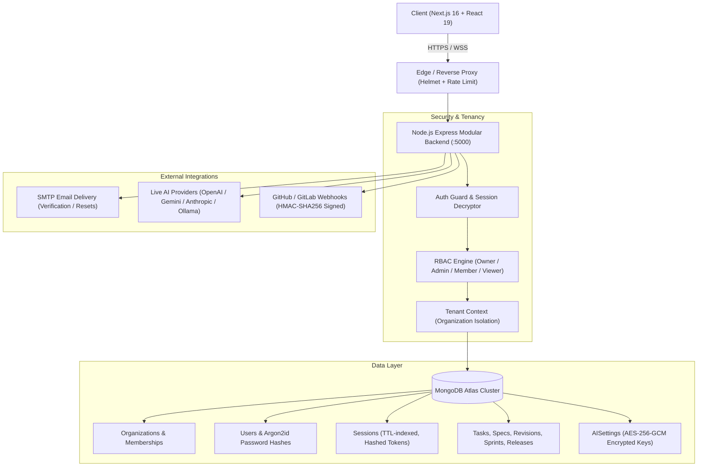

# NOVA Workspace — Production Architecture & Engineering Reference

## 1. Executive Summary

NOVA is a production-grade, multi-tenant software engineering workspace. It consolidates issue tracking, architectural specifications, sprint planning, canary deployments, pull requests, and autonomous AI reasoning under a unified, cryptographically secure tenancy boundary.

---

## 2. System Architecture

---

## 3. Key Components & Implementation

### 3.1 Authentication & Password Security
- **Argon2id** (`argon2.argon2id`): Memory cost 64MB, time cost 3, parallelism 4, with server-side pepper `ARGON2_PEPPER`.
- **Persistent Sessions**: Raw tokens are 256-bit cryptographically secure random bytes held exclusively by the client in `HttpOnly`, `SameSite=Lax`, `Secure` cookies. The database only stores SHA-256 hashes (`tokenHash`), preventing session theft in the event of database exfiltration.
- **Account Lockout Defense**: 5 consecutive failed login attempts lock the account for 15 minutes.
- **No Universal Backdoors**: All hardcoded passwords (`password123`) have been completely removed.

### 3.2 Multi-Tenancy & Authorization
- Every project, task, spec, sprint, release, activity, and notification has an explicit `organizationId` foreign key and composite index.
- Requests pass through `authGuard` which resolves the user's verified tenancy. If an attacker attempts to spoof an `X-Organization-ID` header, the request is rejected with `403 Forbidden` unless the user holds verified membership in that organization.
- Cross-tenant queries are blocked at the database query level with mandatory `{ organizationId }` scoping.

### 3.3 Dynamic User-Configurable AI Provider & Custom Models
- Organizations configure their own LLM provider: **Google Gemini**, **OpenAI**, **Anthropic**, or **Ollama / Self-Hosted**.
- API keys are encrypted at rest using **AES-256-GCM** with a derived SHA-256 key from `SESSION_SECRET` and a unique 12-byte IV per record. Keys are never returned in plaintext to the frontend.
- **No Hardcoded Models**: The `/api/ai/models` endpoint dynamically calls the provider's live model catalog API (e.g. `api.openai.com/v1/models`, `generativelanguage.googleapis.com/v1beta/models`, or Ollama `/api/tags`). Users can select from their enabled models or input custom model tags.

### 3.4 Core Data Persistence & Historical Revision Tracking
- Completely removed file-based `.data/nova-db.json` and `.data/nova-sprints.json`.
- All operations write directly to MongoDB Atlas.
- Specifications maintain complete snapshot history via `SpecRevisionModel` created on every update or approval.

### 3.5 Real Analytics & Insufficient Data Handling
- Cycle times and lead times are calculated dynamically from actual task creation and completion timestamps.
- If fewer than 3 tasks have been completed, the analytics API transparently returns `{ insufficientData: true }` rather than fabricating fake metrics.

### 3.6 Webhook Security & Telemetry Labeling
- Inbound GitHub webhooks verify `X-Hub-Signature-256` using `crypto.timingSafeEqual` and `ENV.GITHUB_WEBHOOK_SECRET`.
- Service mesh and PR pages explicitly include telemetry mode indicators (`mode: "live"` vs `mode: "demo"`) so operators are never misled.
