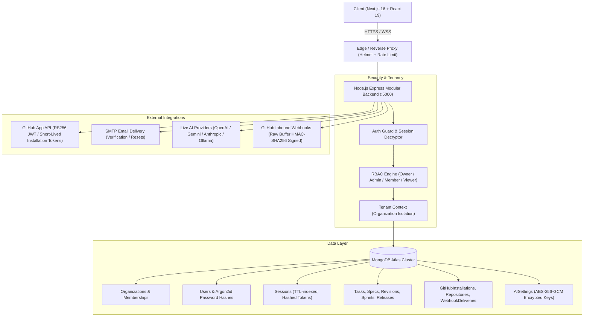
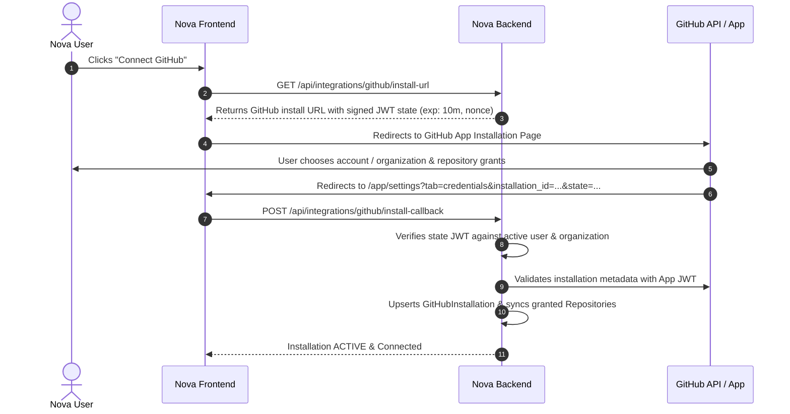

# NOVA Workspace — Production Architecture & Engineering Reference

## 1. Executive Summary

NOVA is a production-grade, multi-tenant software engineering workspace. It consolidates issue tracking, architectural specifications, sprint planning, canary deployments, pull requests, and autonomous AI reasoning under a unified, cryptographically secure tenancy boundary.

---

## 2. System Architecture

---

## 3. GitHub Integration Architecture (Phase 1)

### 3.1 Overview & Architecture Evolution
The legacy Nova system relied on manual Personal Access Tokens (PATs) pasted into integration forms. Phase 1 upgrades Nova to an enterprise-grade **GitHub App architecture**:
- **Zero PAT Management**: Users connect via standard GitHub App installation without sharing raw personal tokens.
- **Short-Lived Installation Access Tokens**: Generated server-side on-demand via RS256 App JWTs signed by the app's private key (`GITHUB_PRIVATE_KEY`). Tokens expire in 60 minutes and are **never** returned to the browser or stored permanently in the database.
- **Dedicated Key Encryption**: Sensitive credentials use AES-256-GCM encryption with `CREDENTIAL_ENCRYPTION_KEY`, decoupled from session rotation secrets.

### 3.2 GitHub App Lifecycle & CSRF Protection

### 3.3 Strict Organization Isolation
Every GitHub resource is isolated strictly within the authenticated Nova organization:
1. **No Global Database Search Fallbacks**: If an org-scoped query for a repository, branch, PR, or task fails, the API immediately returns `404 Not Found` or `403 Forbidden`. The system **never** retries queries globally across all tenants.
2. **Key Collision Safety**: Tasks from separate organizations sharing identical keys (e.g. `NV-101`) cannot cross-contaminate. Webhooks update tasks strictly matching `{ organizationId: resolvedOrgId, key: taskKey }`.
3. **Cross-Tenant Guarding**: Organization A users cannot read, sync, review, merge, or delete Organization B's PRs, nor inspect Organization B's repositories or branches.

### 3.4 Webhook Cryptographic Verification & Idempotency
- **Exact Raw Bytes Verification**: Express captures the verbatim HTTP request body Buffer (`req.rawBody`) before JSON parsing. HMAC-SHA256 is computed directly over `req.rawBody` using `crypto.createHmac("sha256", webhookSecret)` and compared using `crypto.timingSafeEqual`.
- **Delivery Idempotency (`X-GitHub-Delivery`)**: Every incoming delivery ID is recorded in `GitHubWebhookDeliveryModel`. If a duplicate delivery ID is received, the request is immediately acknowledged as duplicate with HTTP 200 without reprocessing tasks, PRs, or activity logs.
- **Trusted Routing**: Organization resolution maps:
  `Webhook -> installation ID / repository full_name -> RepositoryModel / GitHubInstallationModel -> OrganizationModel`.
  Unmapped repositories are safely acknowledged with HTTP 202 and ignored; no global fallbacks or default organizations are used.

### 3.5 Pull Request Tracking & Local Status Distinction
Nova's local database reflects GitHub state via live synchronization:
- **No Autonomous GitHub Merge**: The local workspace "Merge" action only mutates local database tracking state. The UI explicitly identifies this as "Mark Merged (Local)" and informs users that code merge is performed on GitHub.
- **Diff Integrity**: If GitHub cannot return PR file/diff data, Nova returns a clear empty/error state. The system never silently injects synthetic diffs into production repositories.

### 3.6 Legacy PAT Deprecation Strategy
Legacy manual PAT configuration is maintained strictly for backward compatibility and local developer sandboxes:
- Explicitly flagged as **LEGACY / DEPRECATED** in the UI.
- All secrets remain encrypted at rest with AES-256-GCM.
- Inactive by default when a GitHub App installation is connected.

---

## 4. Key Components & Implementation

### 4.1 Authentication & Password Security
- **Argon2id** (`argon2.argon2id`): Memory cost 64MB, time cost 3, parallelism 4, with server-side pepper `ARGON2_PEPPER`.
- **Persistent Sessions**: Raw tokens are 256-bit cryptographically secure random bytes held exclusively by the client in `HttpOnly`, `SameSite=Lax`, `Secure` cookies. The database only stores SHA-256 hashes (`tokenHash`).
- **Account Lockout Defense**: 5 consecutive failed login attempts lock the account for 15 minutes.

### 4.2 Multi-Tenancy & Authorization
- Every project, task, spec, sprint, release, activity, and notification has an explicit `organizationId` foreign key and composite index.
- Requests pass through `authGuard` and `requireOrg` which resolve the user's verified tenancy.

### 4.3 Production Environment Configuration
See `backend/.env.example` for reference. Required GitHub variables:
- `GITHUB_APP_ID`: Numeric GitHub App ID.
- `GITHUB_CLIENT_ID` / `GITHUB_CLIENT_SECRET`: App client credentials.
- `GITHUB_PRIVATE_KEY`: RSA private key (PEM format) for signing RS256 App JWTs.
- `GITHUB_APP_URL`: Public GitHub App installation URL (`https://github.com/apps/<app-name>`).
- `GITHUB_WEBHOOK_SECRET`: Webhook HMAC secret configured in the GitHub App.
- `CREDENTIAL_ENCRYPTION_KEY`: 32+ character key for AES-256-GCM integration secrets.
